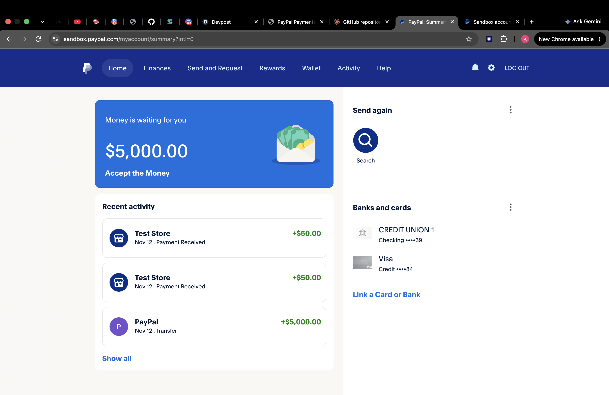
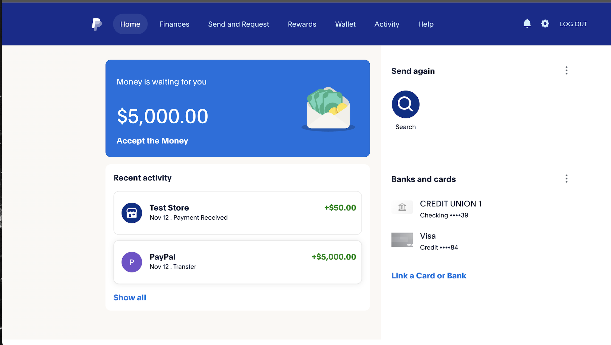
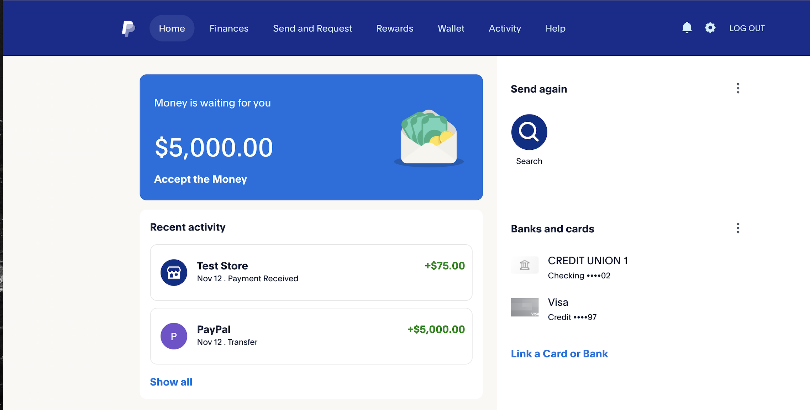

# PayPilot

> Type a payment in plain English. An AI agent understands it, asks you to confirm, and sends it through PayPal.

**Example:** `Pay Meera $50 and Arjun $75`





---

## The Problem

Sending money usually means opening an app, finding the person, typing an amount, choosing a method, and confirming. Sending to several people, or creating an invoice, takes even more steps.

## The Solution

This project is an **AI agent that takes real actions**, not just a chatbot. You describe what you want in everyday language, and the agent works out the details and carries out the payment with a human approval step in between.

---

## Features

| Feature | What it does |
|---|---|
| **Natural-language payments** | "Pay Meera $50" becomes a structured payout request |
| **Multiple payments in one message** | "Pay Meera $50 and Arjun $75" is handled together |
| **Invoices** | "Invoice Arjun $200 for logo design, due Friday" creates an invoice request |
| **Confirm before sending** | A confirm card shows exactly who gets how much. Nothing is sent until you click **Confirm** |
| **Cancel anytime** | Clicking **Cancel** sends nothing |
| **Unknown contact protection** | "Pay Sam $20" is rejected because Sam isn't in the contact list, so no money moves |
| **Safe key handling** | API keys live in `.env`, which is never uploaded to GitHub |

---

## How It Works

```
 You type a command
        |
        v
 Web app (localhost:3000)
        |
        v
 Node.js server  --->  Gemini AI parses the text
        |              into names, amounts, and actions
        v
 Server checks each name against contacts.js
        |
        v
 Confirm card shown to you  --->  Cancel = nothing sent
        |
      Confirm
        v
 PayPal API sends the payout (sandbox)
        |
        v
 Status shown in the app (e.g. PENDING, then SUCCESS)
```

1. **Input:** you type a plain-English instruction.
2. **Understanding:** the Gemini AI model turns it into structured data (who, how much, what action).
3. **Validation:** the server matches names against a known contact list and rejects unknown ones.
4. **Human approval:** the app shows a confirm card with the exact details.
5. **Action:** on confirm, the server calls the PayPal API to send the money.
6. **Feedback:** the app shows the result and status.

---

## Tech Stack

- **Node.js** for the backend server
- **Gemini API** for understanding natural-language commands
- **PayPal API** (sandbox environment) for payouts and invoices
- **HTML, CSS and JavaScript** for the web interface
- **dotenv** for keeping secrets out of the code

---

## Project Structure

```
paypal-agent/
├── server.js        # Main server and routes
├── ai.js            # Gemini AI parsing of commands
├── paypal.js        # PayPal API calls (payouts)
├── contacts.js      # Known contacts (name -> PayPal sandbox email)
├── public/          # Web interface (HTML, CSS, JS)
├── test.js          # Test script
├── package.json     # Project dependencies
├── .env.example     # Template showing which keys are needed
├── .gitignore       # Keeps .env and node_modules out of GitHub
└── screenshots/     # Demo screenshots
```

---

## Getting Started

### Prerequisites
- [Node.js](https://nodejs.org) installed
- A free [Gemini API key](https://aistudio.google.com)
- A free [PayPal Developer](https://developer.paypal.com) account with **Sandbox** accounts (one Business, one or more Personal)

### 1. Clone the repo
```bash
git clone https://github.com/avanichihu/paypal-agent.git
cd paypal-agent
```

### 2. Install dependencies
```bash
npm install
```

### 3. Add your keys
Copy the template and fill in your own values:
```bash
cp .env.example .env
```
Then open `.env` and add your Gemini key and your PayPal sandbox Client ID and Secret.

### 4. Add your contacts
Open `contacts.js` and set each name to the email of a **sandbox Personal account** from the PayPal Developer Dashboard (Testing Tools, then Sandbox Accounts). These look like `sb-xxxx@personal.example.com`.

### 5. Run it
```bash
node server.js
```
Open **http://localhost:3000** in your browser.

---

## Try It Out

| Type this | Expected result |
|---|---|
| `Pay Meera $50` | Confirm card appears. After Confirm, the payout is sent |
| `Pay Meera $50 and Arjun $75` | One confirm card listing both payments |
| `Invoice Arjun $200 for logo design, due Friday` | Invoice details shown for confirmation |
| `Pay Sam $20` | Rejected, because Sam isn't a known contact. Nothing is sent |
| Click **Cancel** on any card | Nothing is sent |

### Checking the money arrived
1. Go to [developer.paypal.com/dashboard](https://developer.paypal.com/dashboard), switch to **Sandbox**, then open **Testing Tools** and **Sandbox Accounts**.
2. Open the Personal account for the person you paid (use the three dots, then **View/Edit Account**) to see their balance.
3. Or log in at **sandbox.paypal.com** (not paypal.com) in an incognito window with that account's fake email and password.

---

## Safety and Responsible AI

Moving money is high stakes, so the agent is built to be careful:

- **Human in the loop:** the AI never sends money by itself. You always approve first.
- **Allow-list of contacts:** payments only go to people listed in `contacts.js`.
- **Sandbox only:** this project uses PayPal's test environment, so no real money is ever moved.
- **Secrets protected:** keys stay in `.env`, which is listed in `.gitignore`.

---

## Future Improvements

- Daily spending cap with warnings
- Payment history panel
- Live status refresh (PENDING to SUCCESS)
- Voice input with a microphone button
- Support for more currencies

---

## Note

This is a hackathon/learning project that runs in the **PayPal sandbox**. Do not use real PayPal credentials with it.

---

Built by **Avani Jain**
